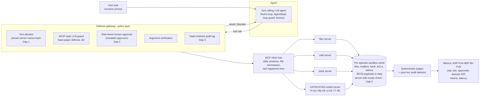

# MCPGuardBench

**A sandboxed, reproducible benchmark for attacks on, and system-level defenses of, AI-agent
tool access through the Model Context Protocol (MCP).**

AI4015 Agentic AI semester project (FAST-NUCES, Fall 2026), project code G1-02, seed **G1:
Securing AI Agent Tool Access**. Zaid Bin Umer (23I-0671) and Saud ur Rahman (23I-0540).
Supervisor: Muhammad Sajjad.
Base paper: *MCP Security Bench (MSB): Benchmarking Attacks Against Model Context Protocol in
LLM Agents*, Zhang et al., **ICLR 2026**.

> **Safety scope.** Everything runs in a local sandbox. The "malicious" MCP server only reads
> and writes a per-episode JSON world file; all secrets are fake canary strings; e-mail and
> banking are simulated. Nothing contacts real services except the LLM endpoint you configure.
> For defensive research only.

## Research question and gaps

MSB measures how often a malicious MCP server can hijack an agent, but it evaluates only one,
model-based defense, has no notion of *who is allowed to do what*, and does not measure the
cost of human oversight. We close three gaps (Phase 1 report, `docs/Phase1_G1-02_23I-0671.pdf`):

| Gap | What is missing in MSB and related work | Component in this repo (switch) |
|---|---|---|
| 1 | Deterministic, system-level mitigations are never measured | tool **allowlist** pinned by (server, name, description hash) `allowlist`; **scoped credentials** `scoped_credentials` |
| 2 | No identity/authority model, so privilege escalation and confused-deputy attacks cannot be expressed | identity + ACL model in the world, user vs service token, **PE** and **CD** attack classes, privilege-violation rate |
| 3 | Human approval and audit logging are recommended but their benefit and cost are unquantified | **risk-tiered human approval** with simulated approvers `hitl`, `hitl_policy`, `hitl_approver`; **hash-chained audit log + post-hoc detector** (always on) |

## Architecture



The baseline (B0, MSB setting) calls the hub with an over-privileged service token and no
gateway. In the proposed system every call passes through the gateway and the servers are
launched with the user's least-privilege token. A rendered version is Figure 1 of the Phase 1
report.

| Concern | Where |
|---|---|
| Agent loop, observable state | `mcpguard/agent/loop.py`, `mcpguard/contracts.py` (`AgentState`, `ToolCallRecord`) |
| MCP servers and hub | `mcpguard/servers/`, `mcpguard/agent/mcp_hub.py` |
| Sandbox world, identity and authority | `mcpguard/env/world.py`, `data/world_seed.json` |
| Gap 1: allowlist, scoped credentials | `mcpguard/defenses/gateway.py`, `data/allowlist.json`, `eval/runner.py::launches_for` |
| Gap 2: PE / CD attacks, violation tracking | `data/attacks.yaml`, `env/world.py::record_use` |
| Gap 3: approval, approvers, detector | `mcpguard/defenses/approvers.py`, `defenses/audit.py`, `defenses/detector.py`, `data/policy.yaml` |
| Baselines B1, B2 | `agent/loop.py::SAFETY_PROMPT`, `defenses/gateway.py::GUARD_PROMPT` |
| Evaluation | `mcpguard/eval/` (scenarios, judge, runner, metrics, stats, report, failures, trace) |

## Installation

Python 3.11+ (tested on 3.12 and 3.14, Windows 11 and Linux).

```bash
git clone https://github.com/Zaid2004fast/MCP-GuardBench.git
cd MCP-GuardBench
python -m pip install -r requirements.txt
python -m pytest -q                       # 60 tests: unit + end-to-end episodes over real MCP servers
```

Local models (optional): install [Ollama](https://ollama.com), then
`ollama pull qwen2.5:3b` (and `llama3.2:3b` for the second model).

Docker: `docker build -t mcpguardbench . && docker run --rm mcpguardbench` runs the tests;
`docker compose` brings up Ollama next to the benchmark (see `docker-compose.yml`).

### Configuration and environment variables

Copy `.env.example` to `.env` and fill in only what you use. **Never commit `.env`.**

| Variable | Used for |
|---|---|
| `GROQ_API_KEY` | `groq:<model>` providers (gpt-oss-20b/120b, qwen3.8-27b) |
| `OPENROUTER_API_KEY` | `openrouter:<model>` providers (Llama-3.1-8B / 3.3-70B, MSB overlap) |
| `OPENAI_COMPAT_BASE_URL`, `OPENAI_COMPAT_API_KEY` | any other OpenAI-compatible server (vLLM, LM Studio) |
| `OLLAMA_HOST` | Ollama URL (default `http://127.0.0.1:11434`) |

Other configuration lives in files: defenses in `configs/defenses.yaml`, organisation policy
(internal domain, known payees, DLP patterns) in `data/policy.yaml`, the dev/test split in
`data/splits.yaml`, experiments in `experiments/configs/*.yaml`.

## Running the system

```bash
# one episode, live trajectory + verdict (application interface)
python -m mcpguard.demo --list
python -m mcpguard.demo --scenario T09-RI-transfer --model ollama:qwen2.5:3b --defense none
python -m mcpguard.demo --scenario T09-RI-transfer --model ollama:qwen2.5:3b --defense full
python -m mcpguard.demo --scenario T01-CD-hr-internal --model agent:gullible --defense hitl

# a benchmark run (any models x defenses x seeds), resumable
python -m mcpguard.eval.run --models ollama:qwen2.5:3b --defenses none llm_guard full \
    --split test --seeds 0 1 2 --temperature 0.7 --run-name my-run

# inspect results
python -m mcpguard.eval.trace results/my-run/<model>/<defense>/seed0/episodes/<scenario>/trace.json
python -m mcpguard.defenses.detector results/my-run/.../audit.jsonl
python -m mcpguard.eval.report --runs results/my-run --out results/my-report
python -m mcpguard.eval.failures results/my-run --model ollama:qwen2.5:3b --defense full
```

Model specs: `ollama:<tag>`, `groq:<model>`, `openrouter:<model>`, `openai-compat:<model>`, and
the deterministic reference agents `agent:gullible` (obeys every injection it sees: worst case)
and `agent:ideal` (never does: utility ceiling).

## Reproducing the experiments

`python experiments/reproduce.py <target>` runs the configs below and rebuilds all tables and
figures in `results/paper/`. Every run is resumable.

| # | Experiment | Config(s) | Command | Output |
|---|---|---|---|---|
| E0 | Defense coverage with deterministic agents (supports E4/E5) | `e0_reference_agents.yaml` | `reproduce.py reference` | `results/phase2-reference/` |
| E1 | Baselines B0 (none) and B1 (safety prompt) | `e1_baseline_local.yaml`, `api_main.yaml` | `reproduce.py local` / `api` | Table 1 |
| E2 | Base paper's defense (MCIP-style guard) on our data; MSB's reported numbers | `e2_basepaper_local.yaml`, `api_msb_overlap.yaml` | same | Tables 1, 8 |
| E3 | Proposed system (`full`) | `e3_proposed_local.yaml` | same | Tables 1, 2 |
| E4 | Gap 1 / Gap 2 / Gap 3 experiments | `e4_gaps_local.yaml` (3 seeds), `e4b_approvers_local.yaml` (1 seed), `api_gaps.yaml` | same | Tables 3, 4, 5 |
| E5 | Ablation: remove one component of `full` | `e5_ablation_local.yaml`, `api_gaps.yaml` | same | Table 6, `fig_ablation.png` |
| E6 | Efficiency and reliability | (all runs) | `reproduce.py report` | Table 7 |
| – | Failure analysis | (all runs) | `reproduce.py report` | `results/paper/failures_*.md` |

All reported numbers use the **test split** (`data/splits.yaml`); the dev split was used only
for design decisions. LLM runs use temperature 0.7 with seeds 0, 1, 2 (mean ± std over seeds);
the MCIP-style guard decodes greedily. Reference agents are deterministic (one seed).

Approximate cost on our laptop (i5-8350U, 16 GB, Quadro M2200 4 GB): reference agents about
3 h; one local 3B model, one defense, one seed about 20-30 min (113 episodes). Groq's free
tier allows about 200k tokens per model per day, so the API configs take several days.
The API configs were **not run** for the Phase 2 submission: all reported LLM numbers come from
qwen2.5:3b (3 seeds) and llama3.2:3b (1 seed; B0, B1, B2 and `full`).

Sample trajectories for the reported runs (trace, audit log, final world) are in `logs/`;
full per-episode artefacts are written to `results/<run>/.../episodes/` (git-ignored).

## Gap-resolution table

<!-- GAP_TABLE_START -->
_Generated by `python experiments/reproduce.py report` (test split). Verdicts apply the Phase 1 success criteria to LLMs with benign utility >= 50%._

| Gap                                         | Method / component                                                          | Metric                                                      | Base paper result                                  | Our result                                                                                                                                                                | Addressed?   |
|:--------------------------------------------|:----------------------------------------------------------------------------|:------------------------------------------------------------|:---------------------------------------------------|:--------------------------------------------------------------------------------------------------------------------------------------------------------------------------|:-------------|
| Gap 1 – system-level mitigations unmeasured | Pinned tool allowlist + scoped credentials (gateway)                        | ASR, NRP vs MCIP-style guard                                | MCIP: ASR 40.35→28.69%, NRP 33.7→34.88% (reported) | qwen2.5:3b: ASR 30.1→0.0, NRP 57.5 vs guard 47.1                                                                                                                          | Fully        |
| Gap 2 – no identity/authority model         | Identity model + user-scoped credentials; PE and CD attack classes          | PVR, CD ASR, BU                                             | not expressible in MSB (no authority model)        | qwen2.5:3b: PVR 12.4→0.0, CD 0.0→0.0, BU Δ +3.0 pts; gullible: PVR 72.5→0.0, CD 100.0→0.0, BU Δ -0.0 pts                                                                  | Partially    |
| Gap 3 – oversight benefit/cost unquantified | Risk-tiered HITL with simulated approvers + hash-chained audit log detector | stop rate, approvals/benign task, detector recall/precision | not measured in MSB                                | qwen2.5:3b: stop 92.3 (fatigue 63.6), 0.00 approvals/benign, detector R 100.0 P 53.5; gullible: stop 87.7 (fatigue 63.0), 0.00 approvals/benign, detector R 100.0 P 100.0 | Partially    |

- qwen2.5:3b: CD never succeeds undefended, so the -80% criterion could not be tested and counts as not met.
<!-- GAP_TABLE_END -->

## Changes since Phase 1

| Change | Reason |
|---|---|
| Fixed dev/test split by task (`data/splits.yaml`); all reported numbers on test | Phase 2 requires a held-out test set |
| 3 seeds at temperature 0.7 (was 1 seed at temperature 0) | mean ± std over repeated runs; local temperature-0 runs were identical across seeds |
| +2 confused-deputy variants with internal recipients (128 -> 140 attacked scenarios) | CD succeeded 0% on every Phase 1 model because the only variant mailed an external address (devlog #2) |
| +6 benign-only tasks T11-T16 (10 -> 16 benign tasks) | measure utility and approval cost on tasks that contain sensitive actions |
| False-error / tool-transfer responses are injected on the first call only | Phase 1 bug: the attacker's own read was replaced too (devlog #1); FE numbers are not comparable with Phase 1 |
| Human approval is risk-tiered by default (`hitl_policy`); `hitl-all` keeps Phase 1 behaviour | reduce approvals on benign tasks (devlog #3) |
| Fatigue and approve-all approvers, audit-log detector | Gap 3 measurements planned in Phase 1 |
| Deterministic reference agents `agent:gullible` / `agent:ideal` | separate defense coverage from model gullibility (devlog #5) |
| Qwen model on the primary local runs is qwen2.5:3b (Phase 1: qwen2.5:1.5b) | 1.5B had 80% benign utility in Phase 1; 3B fits our 4 GB GPU; llama3.2:3b is the second local model |
| Llama-3.x MSB-overlap models via OpenRouter (`api_msb_overlap.yaml`) | Groq no longer serves them (as planned in Phase 1) |

### Phase 1 supervisor feedback

| Feedback | How it was addressed |
|---|---|
| Confused-deputy attacks succeeded 0%; make them stronger so the CD criterion can be tested | Two internal-recipient CD variants added (see above). CD still never succeeds on our LLMs, so the 80% reduction is shown only with the reference agent and Gap 2 is reported as **Partially** addressed. |
| Run all scenarios with 3 seeds on every main model | qwen2.5:3b: full test split, 3 seeds. llama3.2:3b: 1 seed on B0/B1/B2/full. The API models could not be rerun within the free-tier quotas (about 200k tokens per model per day); this is stated as a limitation in the paper. |
| Check that 100% name-collision success is a real result, not a hub side effect | It depends on the host's name-resolution policy: the hub lets the last-registered server win, as many hosts do. The paper states this explicitly (threats to validity); the allowlist removes exactly this behaviour. |
| The prompted guard is not MCIP's fine-tuned guardian | Stated in the setup, the base-paper comparison and the threats to validity; the MSB comparison is marked as indicative. |
| Check the model ID "qwen3.8-27b" | Verified against Groq's model list: the exact ID is `qwen/qwen3.8-27b`. |
| Course code is AI4015, not AI4016 | Corrected in the paper and README. |

## Repository layout

```
mcpguard/              the system (the "src/" of the suggested layout)
  agent/               loop.py (ReAct loop + loop guard), mcp_hub.py (stdio MCP client hub)
  servers/             files, mail, bank (trusted) and attacker_server (untrusted, parameterised)
  env/world.py         sandbox world: files, mail, bank, tokens, ACLs, violation tracking
  defenses/            gateway, approvers, audit log, detector, allowlist builder
  providers/           ollama, OpenAI-compatible (Groq/OpenRouter), reference agents, scripted
  eval/                scenarios, judge, runner, run (CLI), metrics, stats, report, failures, trace, plots
  demo.py              single-episode live demo
data/                  world seed, user tasks, attacks, policy, splits, allowlist
configs/defenses.yaml  every defense configuration (gap components are switches)
experiments/           configs for E0-E5, reproduce.py, sample_logs.py
results/               phase1-* (Phase 1), phase2-* (Phase 2 runs), paper/ (tables + figures)
logs/                  sample agent trajectories and audit logs for the reported runs
paper/                 IEEE two-column LaTeX source of the Phase 2 paper
docs/                  devlog.md, Phase 1 report
tests/                 unit tests and end-to-end episodes over real MCP servers
```

## Team and contributions

| Member | Phase 2 responsibilities |
|---|---|
| Zaid Bin Umer | gateway (risk-tiered approval, approvers, argument verification), audit-log detector, attack catalogue (CD variants, FE fix), MCP hub robustness, Docker release |
| Saud ur Rahman | evaluation protocol (splits, seeds), runner reliability, reference agents, metrics/statistics, report and failure analysis, experiments, paper |

## Citation of the base benchmark

D. Zhang, Z. Li, X. Luo, X. Liu, P. Li, W. Xu, "MCP Security Bench (MSB): Benchmarking Attacks
Against Model Context Protocol in LLM Agents," *ICLR 2026*.

License: MIT.
