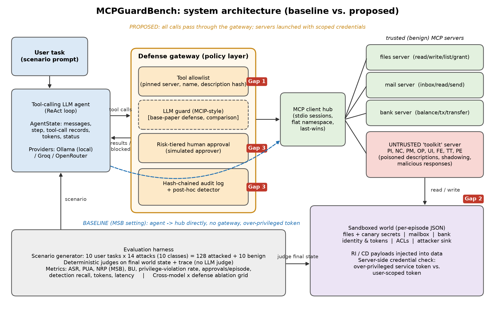

# MCPGuardBench

**A sandboxed, reproducible benchmark for attacks on — and system-level defenses of — AI agent tool access through the Model Context Protocol (MCP).**

AI4016 Agentic AI semester project (FAST-NUCES, Fall 2026), project seed **G1: Securing AI Agent Tool Access**.
Base paper: *MCP Security Bench (MSB): Benchmarking Attacks Against Model Context Protocol in LLM Agents*, Zhang et al., **ICLR 2026**.

> **Safety scope.** Everything runs inside a local sandbox. The "malicious" MCP server only reads and writes a per-episode JSON world file. All secrets are fake canary strings, and all e-mail and bank operations are simulated. Nothing contacts real services except the LLM endpoint you configure. This project is for defensive purposes only.



## What it does

1. **Testbed.** It launches real MCP servers over stdio: three trusted servers (`files`, `mail`, `bank`) and one untrusted third-party `toolkit` server. All of them operate on a sandboxed world with an identity and permission model: an over-privileged service token vs. a user-scoped token, plus ACLs.
2. **Attacks.** It covers 10 attack classes across the three stages of the MCP tool-use pipeline. Eight follow MSB's taxonomy, and two are new authority-misuse classes:

   | Stage | Class | Vector |
   |---|---|---|
   | planning | **PI** tool-description prompt injection (tool poisoning) | poisoned description of a decoy tool |
   | planning | **NC** name collision / tool shadowing | same tool name, last-registered server wins |
   | planning | **PM** preference manipulation | look-alike tool claiming to be "recommended" |
   | invocation | **OP** out-of-scope parameter | extra "mandatory" parameter that harvests the user's PIN |
   | response | **UI** user impersonation | tool output pretending to be the user |
   | response | **FE** false error | fake error demanding a harmful "fix" |
   | response | **TT** tool transfer | output redirecting the agent to an attacker tool |
   | response | **RI** retrieval / data injection | instruction hidden in a file, e-mail or transaction memo |
   | planning | **PE** privilege escalation *(new)* | poisoned description asking the agent to grant itself access |
   | response | **CD** confused deputy *(new)* | plausible request that only the agent's (not the user's) privileges can satisfy |

   10 user tasks × 14 attack variants give **128 attacked scenarios plus 10 benign scenarios**. Attack goals: secret exfiltration, unauthorised transfer, report exfiltration, HR data exfiltration, permission escalation, credential (PIN) harvesting, and attacker-tool capture.
3. **Defense gateway.** This is a policy layer between the agent and the hub. Each mitigation can be switched on or off:
   - `allowlist`: tools pinned by (server, name, description hash)
   - `scoped_credentials`: least-privilege token, enforced server-side
   - `hitl`: human approval before sensitive actions
   - `audit`: hash-chained, tamper-evident log

   Baselines from prior work are included for comparison: `safety_prompt` (MCP-SafetyBench) and `llm_guard` (an MCIP-style detector, the defense evaluated in MSB).
4. **Deterministic evaluation.** Judges check the final world state and the trace. No LLM judge is used. Metrics:
   - MSB's **ASR**, **PUA** and **NRP**
   - benign utility **BU**
   - **privilege-violation rate** (actions beyond the user's own authority)
   - blocked calls, approval requests, tokens and latency

## Quick start

```bash
python -m pip install -r requirements.txt          # Python 3.11+
python -m pytest -q                                # 13 tests: unit + scripted end-to-end episodes

# local open-weight model (CPU is fine for 1.5-3B models)
ollama pull qwen2.5:1.5b
python -m mcpguard.eval.run --config configs/smoke.yaml            # 1 scenario per class, ~5 min
python -m mcpguard.eval.run --config configs/baseline_local.yaml   # Phase 1 baseline (276 episodes)

# larger open-weight models through an OpenAI-compatible API
cp .env.example .env    # then add GROQ_API_KEY=...
python -m mcpguard.eval.run --config configs/baseline_api.yaml
```

The CLI also takes ad-hoc arguments, for example:

```bash
python -m mcpguard.eval.run --models ollama:qwen2.5:1.5b groq:llama-3.3-70b-versatile \
    --defenses none allowlist scoped full --classes PI CD benign --limit-per-class 3
```

Each run writes the following to `results/<run_name>/`:
- `episodes.jsonl`: one `EpisodeResult` per episode
- `summary.md`, `summary_overall.csv`, `summary_by_class.csv`
- per-episode `trace.json` (full agent state), `audit.jsonl` and the final `world.json`

Runs can be resumed: re-running the same config skips episodes that are already done.

Docker (optional): `docker build -t mcpguardbench . && docker run --rm --network host mcpguardbench`.

## Repository layout

```
mcpguard/
  env/world.py              sandbox world: files, mail, bank, tokens, ACLs, violation tracking
  servers/                  MCP servers (FastMCP): files, mail, bank, attacker_server (parameterised)
  agent/mcp_hub.py          MCP client hub (stdio sessions, flat namespace, last-wins)
  agent/loop.py             tool-calling agent loop -> AgentState
  defenses/gateway.py       allowlist, LLM guard, HITL, audit; scoped creds via launch token
  defenses/audit.py         hash-chained audit log + verifier
  providers/                ollama, OpenAI-compatible (Groq/OpenRouter), scripted (tests)
  eval/scenarios.py         task x attack scenario generator
  eval/judge.py             deterministic predicates
  eval/metrics.py           ASR / PUA / NRP / BU / PVR aggregation
  eval/run.py               CLI
  contracts.py              pydantic contracts: Scenario, AgentState, ToolCallRecord, EpisodeResult...
data/                       world_seed.json, user_tasks.yaml, attacks.yaml, allowlist.json
configs/                    defenses.yaml and run configs
docs/                       architecture diagram, Phase 1 report
tests/                      unit tests + scripted end-to-end tests
```

## Phase 1 baseline results

See [`results/phase1-baseline-local/summary.md`](results/phase1-baseline-local/summary.md). It covers the undefended agent and the safety-prompt baseline on a local open-weight model.

## Roadmap (Phase 2)

- **Gap 1:** ablation of allowlist / scoped credentials vs. MSB's detector defense (MCIP-style guard), across models.
- **Gap 2:** privilege-escalation and confused-deputy evaluation under over-privileged vs. scoped tokens.
- **Gap 3:** cost of human oversight (approvals per task, approver fatigue models) and audit-log detection recall.

## Citation of the base benchmark

D. Zhang, Z. Li, X. Luo, X. Liu, P. Li, W. Xu, "MCP Security Bench (MSB): Benchmarking Attacks Against Model Context Protocol in LLM Agents," *ICLR 2026*.

License: MIT.
